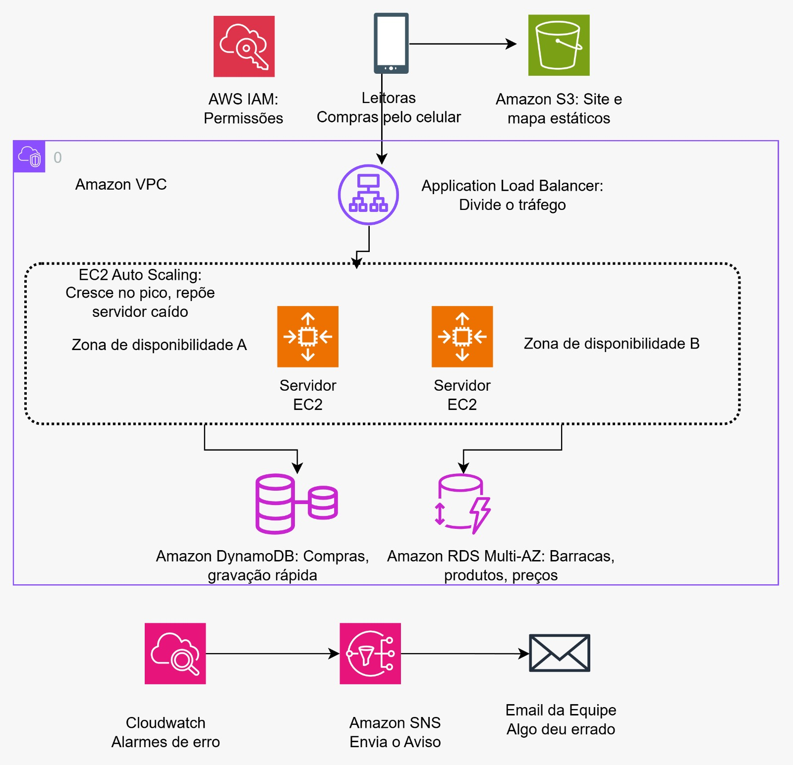
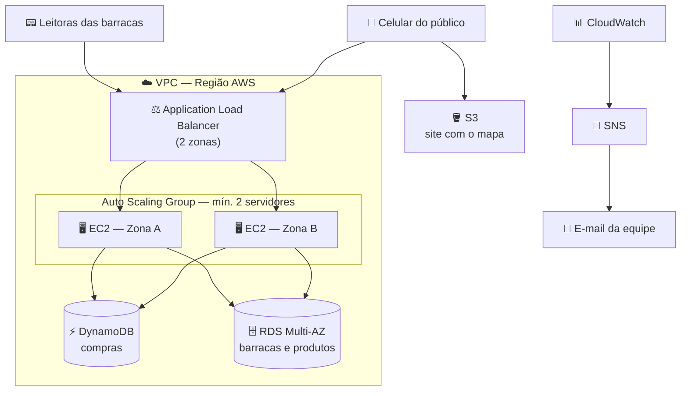

# 🎟️ MaréPay

### Arquitetura em nuvem na AWS para o festival que só aceita pulseira

---

## 📖 Sobre o projeto

O **Maré Sonora** é um festival de música com milhares de pessoas. Lá dentro não se usa dinheiro nem cartão: cada pessoa recebe uma **pulseira com chip** e paga encostando a pulseira na leitora da barraca de comida ou bebida.

O **MaréPay** é o sistema que recebe e guarda essas compras. Este repositório documenta a **arquitetura na AWS** proposta para ele, desenhada para ser **rápida, resiliente e capaz de aguentar o pico** que acontece quando um show termina e todo mundo vai comprar ao mesmo tempo.

> 💡 A arquitetura é parecida com a do projeto AgroSensor visto em aula. No lugar dos sensores das estufas, quem envia os dados são as **leitoras das barracas**.

---

## 🏗️ Arquitetura

Resumo do fluxo em forma de diagrama:

---

## 🧩 Serviços utilizados

| Serviço | Para que serve | O que faz no MaréPay |
|---|---|---|
| **Amazon VPC** | Rede privada e isolada na AWS | Rede onde ficam balanceador, servidores e banco, com sub-redes em 2 zonas |
| **Application Load Balancer** | Porta de entrada única; distribui pedidos e testa a saúde dos servidores | Recebe as compras das leitoras e envia só para servidores saudáveis |
| **Amazon EC2** | Computador virtual alugado | Roda a API que valida e grava cada compra |
| **EC2 Auto Scaling** | Cria e remove servidores automaticamente | Recria servidor que cai e escala no pico |
| **Amazon DynamoDB** | Banco NoSQL serverless, muito rápido | Guarda todas as compras |
| **Amazon RDS** | Banco relacional (SQL) gerenciado | Guarda o cadastro de barracas e produtos com preços |
| **Amazon S3** | Armazenamento de arquivos | Hospeda o site do mapa e o código da API |
| **Amazon CloudWatch** | Métricas e alarmes | Monitora a carga e dispara alarmes |
| **Amazon SNS** | Envio de avisos por tópicos | Manda o e-mail para a equipe |
| **AWS IAM** | Controle de permissões | Dá aos servidores credenciais temporárias, com menor privilégio |

---

## ✅ Requisitos × solução

| # | Requisito | Solução |
|---|---|---|
| 1 | Receber compras das leitoras pela internet | ALB + EC2 |
| 2 | Guardar todas as compras, com gravação rápida | DynamoDB |
| 3 | Guardar cadastro de barracas e produtos com preços | RDS |
| 4 | Site simples com o mapa, aberto no celular | S3 (site estático) |
| 5 | Continuar funcionando se um servidor cair | ALB + Auto Scaling em 2 zonas |
| 6 | Aguentar o pico de compras no fim do show | Auto Scaling (target tracking) |
| 7 | E-mail para a equipe quando algo der errado | CloudWatch + SNS |

---

## 🗄️ Por que dois bancos de dados?

| | ⚡ DynamoDB | 🗄️ RDS |
|---|---|---|
| **O que guarda** | Compras com as pulseiras | Barracas e produtos com preços |
| **Volume** | Enorme, cresce o tempo todo | Pequeno |
| **Como é consultado** | Por chave: id da pulseira + data e hora | Por SQL, com relações entre tabelas |
| **Ponto forte** | Grava muito rápido e escala sozinho | Relações e consultas flexíveis |

Usar o banco certo para cada tipo de dado chama-se **persistência poliglota**.

---

## 🛡️ Resiliência e escalabilidade

### Se um servidor cair
1. O **ALB** faz o health check e deixa de enviar pedidos a ele.
2. O outro servidor, em outra zona, continua atendendo.
3. O **Auto Scaling** percebe que há menos servidores que o desejado e cria um novo a partir do launch template.

Como a API é **stateless** (não guarda dados na memória), nada se perde.

### No pico após um show
1. O **CloudWatch** mede a carga (pedidos por servidor).
2. O **Auto Scaling** cria mais servidores, até o máximo definido.
3. O **ALB** distribui os pedidos entre todos, inclusive os novos.
4. O **DynamoDB** absorve as gravações sem ajuste.
5. Quando o movimento cai, o Auto Scaling reduz os servidores para economizar.

---

## 🔐 Segurança

- **Security Groups encadeados:** a internet fala só com o ALB; os servidores só aceitam o ALB; o banco só aceita os servidores.
- **Banco sem acesso público.**
- **Papel IAM** nos servidores, com credenciais temporárias e menor privilégio. Nenhuma senha no código.
- **Criptografia** em repouso e em trânsito (HTTPS), por se tratar de dados de pagamento.
- **Backups e Multi-AZ** no RDS para proteger os dados.

---

## 🤖 Uso de Inteligência Artificial

| IA | Onde foi usada | Como foi usada |
|---|---|---|
| **Claude (Anthropic)** | Preparação para a prova e redação das respostas das Questões 1, 2 e 3 | Explicação da apostila e dos conceitos, material de estudo, orientação de como montar a arquitetura do caso e preenchimento do modelo de prova |
| **Miro (IA)** | Figura da arquitetura (`arquitetura.png`) | `<descreva o que foi pedido ao Miro>` |

---

## 👤 Autor

**Nome:** `<seu nome>`
**RA:** `<seu RA>`
**Curso:** Análise e Desenvolvimento de Sistemas — Universidade São Judas Tadeu
**Disciplina:** Sistemas Distribuídos & Mobile

---

Feito com ☁️ e muito estudo.

